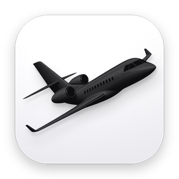
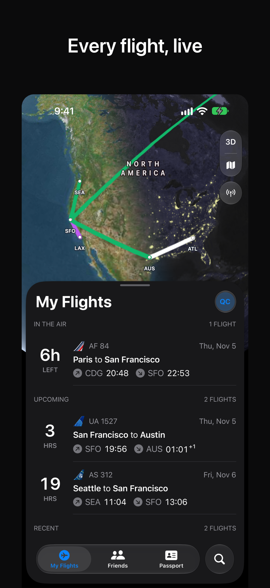
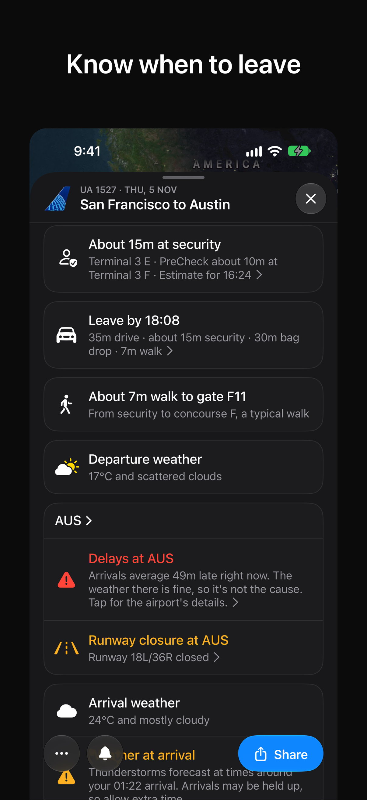
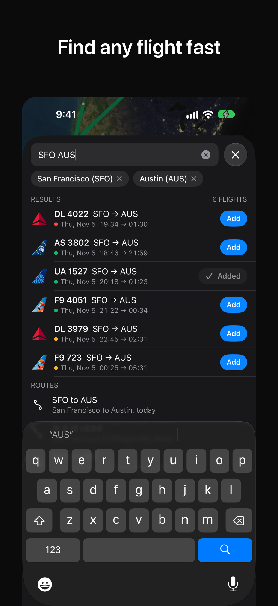
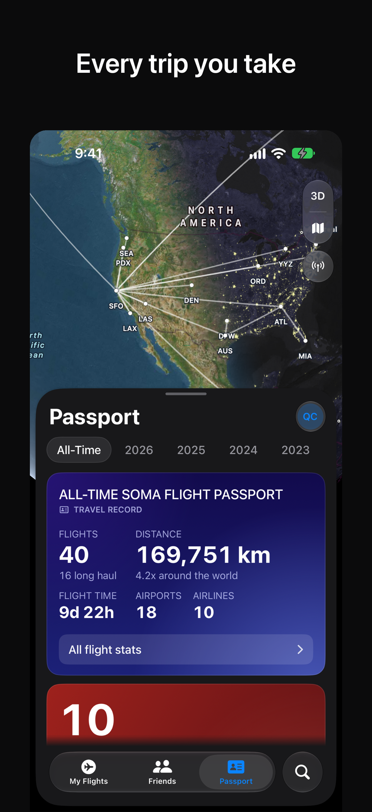
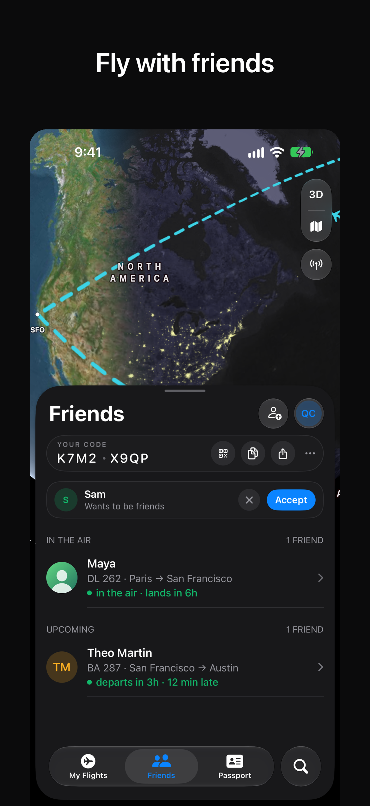
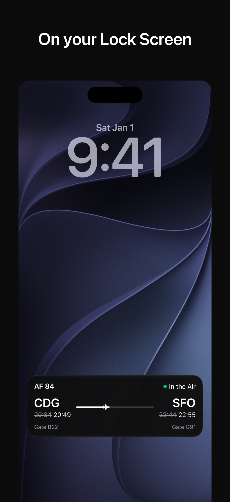
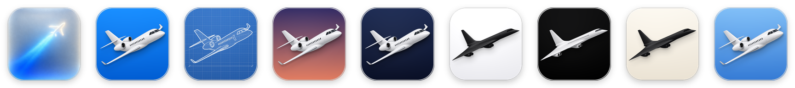

<div align="center">



# Soma Flight

**Live flight status and a log of every trip. For iPhone, Mac and Apple Watch.**

[](https://testflight.apple.com/join/RWVpDdDF)
[](https://somalabs.me)
[](LICENSE)


**[Try it](#try-it)** · **[Features](#features)** · **[Privacy](#privacy)** · **[Build from source](#build-from-source)** · **[FAQ](#faq)** · **[Docs](#documentation)** · **[License](#license)**

</div>

Soma Flight is an open source flight tracker for iPhone, iPad, Mac and Apple Watch that follows your flights live (times, gates, delays, push alerts, a Live Activity) and keeps a log of every flight you take, with stats, a route map, CO2 estimates and a Schengen 90/180 day count. The code is AGPL-3.0, including the Supabase backend, so you can run your own server. It is in public beta on TestFlight; App Store version 1.0 is on its way, and a web version is an early first cut. It has no ads, no analytics SDK and no tracking.

| My Flights | Flight | Search | Passport | Friends | Live Activity |
|---|---|---|---|---|---|
|  |  |  |  |  |  |

Screenshots show demo data.

## At a glance

| | |
|---|---|
| What | Flight tracker and flight log (live status, alerts, history, stats) |
| License | GNU AGPL-3.0 for the code. Airline names, logos and other third-party marks are excluded, see [NOTICE](NOTICE) |
| Apps | iPhone and iPad (iOS 26+), Mac (macOS 26+), Apple Watch (watchOS 26+), widgets, Live Activities, Siri and Shortcuts |
| Web | `Apps/Web` (Vite, React 19, TypeScript), a first cut of the same app in the browser |
| Stack | SwiftUI (`Packages/FlightKit`), Rust core `flightcore` (UniFFI for Swift, WASM for the backend and web), Supabase (Postgres, Deno Edge Functions) |
| Flight data | [FlightAware AeroAPI](https://www.flightaware.com/commercial/aeroapi/) by default; Aviationstack, FlightLabs and OpenSky adapters for testing; NOAA aviationweather.gov for METAR and TAF; FAA NAS status |
| Version | 1.0 (`MARKETING_VERSION` in `project.yml`), `flightcore` 0.1.0 |
| Status | Public TestFlight beta. App Store 1.0 pending. Web app is a first cut |
| Install | [TestFlight public link](https://testflight.apple.com/join/RWVpDdDF), or build from source with `xcodegen generate` |
| Homepage | [somalabs.me](https://somalabs.me) |
| Made by | [Soma Labs](https://somalabs.me) |

## Try it

- **TestFlight (iPhone):** [join the public beta](https://testflight.apple.com/join/RWVpDdDF).
- **App Store:** version 1.0 is on its way. This line will link to it once it is live.
- **Website:** [somalabs.me](https://somalabs.me) · [Privacy policy](https://somalabs.me/legal/soma-flight-privacy) · [Support](https://somalabs.me/support)

## Features

### Follow a flight

- **Search any flight.** By flight number, airline name or route ("AF 84", "air france 84", "SFO AUS"), for a day from 10 days back to 2 days ahead. Follow it in one tap. Times, gates, terminals and delays update on their own. See [How to track a flight](docs/guides/track-a-flight.md).
- **Push alerts.** Delays, gate and terminal changes, baggage belt, departure, takeoff, landing, arrival, cancellation, diversion, a late inbound plane, a predicted delay, a connection at risk and FAA ground stops. Each category has its own switch. See [Which flight alerts Soma Flight sends](docs/guides/flight-alerts.md).
- **On your Lock Screen.** A Live Activity shows the countdown to departure, the time left in the air and the arrival gate, on the Lock Screen and in the Dynamic Island. Widgets keep your next flight on the Home Screen.
- **Apple Watch.** My Flights and each flight's screen on the wrist, with complications, from the iPhone's snapshot. Works offline. See [Apple Watch app](docs/guides/apple-watch-app.md).
- **Leave on time.** A "Leave by" time from the drive, the security queue (US airports), the bag drop margin, the walk to the gate and the boarding call. See [When to leave for the airport](docs/guides/leave-for-the-airport.md).
- **Connections.** When you follow two flights that connect, the flight sheet says whether the layover is enough for that airport, and an alert fires when it gets tight. See [Will I make my connection?](docs/guides/connection-at-risk.md).
- **No signal in the air.** The flight sheet keeps the flight on the device before departure and estimates where the plane is when there is no connection, clearly marked as an estimate. See [Offline flight position](docs/guides/offline-flight-position.md).
- **Siri and Shortcuts.** "Next Flight Status", "Flight Status", "Open Flight", "Open Next Flight" and "Find a Flight" actions.

### Keep a log

- **Passport.** Flights you take land in your Passport an hour after the gate: a map of every route, distance flown, hours in the air, airports, airlines, aircraft and delays. Year in Review and a route poster. See [Flight passport and stats](docs/guides/flight-passport-stats.md).
- **Import.** From another tracker's CSV export (Flighty's "Export Flights"), any CSV with a date, a from and a to column, your calendar, or a confirmation email you share with the app. Everything is read on the device. A boarding pass (a Wallet `.pkpass` file or a picture of its barcode) finds and follows its flight and stays on the device for the gate. See [How to import past flights](docs/guides/import-past-flights.md).
- **Export.** Your whole history as JSON or CSV, built on the device. See [How to export your flight history](docs/guides/export-flight-history.md).
- **CO2 per flight.** An estimate of each flight's CO2e for one passenger from the UK government (DESNZ) 2025 factors, with radiative forcing, computed on the phone. See [CO2 per flight](docs/guides/co2-per-flight.md).
- **Schengen 90/180.** Days spent in the Schengen area in the last 180, worked out from your flights. See [Schengen day counter](docs/guides/schengen-day-counter.md).

### Airports and people

- **Airports.** Weather in plain words from the latest METAR, the TAF forecast, the flight category, FAA programs (ground stops, ground delay programs, closures) for US airports, and the airlines that fly there. See [Airport weather and METAR](docs/guides/airport-weather-metar.md).
- **Friends.** Invite friends with a link and see their upcoming flights next to yours. You choose what they see. Share a single flight with a public link you can revoke.
- **Travel documents.** Loyalty numbers and passport details, sealed with AES-GCM on the device before they sync. The key stays in your iCloud Keychain.
- **Your icon.** Pick from more than 20 app icons: jets and a supersonic in every colour, blueprint and dusk, plus a contrail glowing in frosted glass.

<p align="center"></p>

## Privacy

- No ads, no analytics SDK, no tracking.
- Soma Flight never reads your mailbox or your contacts. Email import only reads a message you share or forward to the app, on the phone.
- Location is asked only for "Leave by", to compute the drive, and it never leaves the device. The camera is used only to scan a boarding pass.
- Settings > Account lets you export your data or delete your account. Deleting a Sign in with Apple account also revokes the Apple token.

The full policy is at [somalabs.me/legal/soma-flight-privacy](https://somalabs.me/legal/soma-flight-privacy).

## Use cases

- Use Soma Flight to follow a friend's or family member's flight and get a push when it lands.
- Use Soma Flight to see the arrival gate and baggage belt on your Lock Screen while you taxi in.
- Use Soma Flight to know when to leave for the airport, counting the drive and the security queue.
- Use Soma Flight to check whether a tight connection is still makeable before you land.
- Use Soma Flight to keep a lifetime log of your flights, with distance, hours in the air and a route map.
- Use Soma Flight to move your history out of another tracker through its CSV export.
- Use Soma Flight to estimate the CO2e of the flights you took this year.
- Use Soma Flight to count your days in the Schengen area against the 90/180 rule.
- Use Soma Flight as a starting point for your own flight app: the Rust core, Swift package and Supabase backend are all AGPL-3.0.

## Build from source

You need Xcode 27 and [XcodeGen](https://github.com/yonaskolb/XcodeGen). The Rust core ships prebuilt in `Packages/FlightCoreFFI`; you need a Rust toolchain only to change it (`core/scripts/build-xcframework.sh` rebuilds the binding).

```bash
git clone https://github.com/soma-intelligence/Soma_Flight.git
cd Soma_Flight && xcodegen generate && open SomaFlight.xcodeproj
```

Debug builds run on fakes and need no account or key: run the iOS scheme on a simulator with the launch argument `-useFakes YES`. To use a real backend, run `supabase start` in this folder and point `Apps/*/Config.Debug.xcconfig` at it. Release builds refuse to start without real configuration.

The backend lives in `supabase/`: Postgres migrations, seed data and Deno Edge Functions. Flight data comes from [FlightAware AeroAPI](https://www.flightaware.com/commercial/aeroapi/), which needs your own key. See [docs/operations.md](docs/operations.md) and [docs/api-contract.md](docs/api-contract.md).

More detail: [Build Soma Flight from source](docs/guides/build-from-source.md) and [Self-host the backend on Supabase](docs/guides/self-host-supabase-backend.md).

## How it works

```
iOS, iPadOS, macOS, watchOS apps (Apps/)      Web app (Apps/Web)
            │                                        │
   FlightKit (SwiftUI, stores, services)       React + TanStack Query
            │                                        │
   FlightCoreFFI (UniFFI) ── flightcore (Rust) ── flightcore-wasm
            │                                        │
            └──────── Supabase: Postgres + RLS, Edge Functions (Deno) ────────┘
                                 │
        FlightAware AeroAPI (alerts webhook), aviationweather.gov, FAA NAS status
```

- **`core/flightcore`**: pure Rust logic with no I/O, network or clock reads: passport and aircraft stats (`passport.rs`, `passport_detail.rs`, `aircraft.rs`), delay and gate predictions (`predict.rs`), airport board delay stats (`delay.rs`), weather impact from METAR and TAF (`impact.rs`, `weather.rs`) and geo. The apps call it through UniFFI (`core/flightcore-ffi`, `Packages/FlightCoreFFI`); the Edge Functions and the web app through WASM (`core/flightcore-wasm`).
- **`Packages/FlightKit`**: the shared SwiftUI app, stores, services and tests. Smaller products for the extensions: `FlightActivityKit` (widgets and Live Activity), `FlightWatchKit` (Watch app and complications), `FlightImportKit` (the share extension's email reader).
- **`supabase/`**: migrations with row level security on every user table, seed data (airports, airlines, aircraft types), pgTAP tests in `supabase/tests`, and 29 Edge Functions (`flight-lookup`, `follow-flight`, `flight-position`, `aeroapi-webhook`, `push-sender`, `airport-weather`, `airport-board`, `faa-status`, `friends`, `share-flight` and more). pg_cron jobs archive landed flights, prune caches and sweep FAA programs.
- **Alerts without polling.** With AeroAPI, the provider calls `aeroapi-webhook`; one SQL transaction merges the change into `flights` and writes `flight_events`, then `push-sender` sends APNs alerts and Live Activity updates. A daily spend cap (`AEROAPI_DAILY_CAP_USD`) bounds the provider bill.

## Repository layout

- `Apps/`: the iOS, macOS and watchOS app targets, widgets, share extension and App Intents, generated from `project.yml`.
- `Packages/FlightKit`: the shared SwiftUI app, services and tests.
- `core/` and `Packages/FlightCoreFFI`: the Rust core (`flightcore`) and its Swift bindings.
- `Apps/Web`: the web app (Vite, React), a first cut of the same app in the browser; see [its README](Apps/Web/README.md).
- `supabase/`: migrations, seed data, SQL tests and Edge Functions.
- `docs/`: API contract, operations, data sources, method notes and the [guides](docs/guides/).

## Comparison with other flight trackers

Neutral facts as of November 2026. Soma Flight is a young project in beta; the others are established products.

| | Soma Flight | Flighty | Flightradar24 | FlightAware | App in the Air | TripIt |
|---|---|---|---|---|---|---|
| Source code | Open (AGPL-3.0) | Closed | Closed | Closed | Closed | Closed |
| Run your own backend | Yes (Supabase) | No | No | No | No | No |
| Focus | Your flights: status, alerts, log | Your flights: status, alerts, log | Live map of air traffic | Flight tracking and aviation data | Travel assistant | Itinerary organiser |

Soma Flight is not affiliated with any of these companies. It uses FlightAware AeroAPI as its default flight data source. See [Open source alternatives to Flighty, Flightradar24 and other trackers](docs/guides/open-source-flight-tracker-alternatives.md).

## FAQ

**Is Soma Flight free?**
The app is free to download from TestFlight and has no ads. The code is free software under AGPL-3.0. Running your own backend means paying for your own flight data key (FlightAware AeroAPI) if you want live data.

**Is Soma Flight open source?**
Yes. The apps, the Rust core, the web app and the Supabase backend are AGPL-3.0. Airline logos and other third-party marks are not covered by that license (see [NOTICE](NOTICE)).

**Is there an open source alternative to Flighty?**
Soma Flight is one: an AGPL-3.0 flight tracker with live status, push alerts, a Live Activity, a flight log with stats, and import from Flighty's CSV export. It is not affiliated with Flighty.

**Can I import my flights from Flighty?**
Yes. Export your flights to CSV from that app's settings, then in Soma Flight open Import and pick "Import from Flighty". See [How to import past flights](docs/guides/import-past-flights.md).

**Does Soma Flight work offline or on airplane Wi-Fi?**
Partly. Before departure the app keeps the flight, both airports and the route on the device, so the flight sheet still shows an estimated position, progress and phase with no connection. The Watch app works from its last snapshot.

**Does Soma Flight track me or sell my data?**
No. There are no ads, no analytics SDK and no tracking. Location is used only for "Leave by" and stays on the device.

**Where does the flight data come from?**
FlightAware AeroAPI by default. Weather comes from NOAA's aviationweather.gov and US airport programs from the FAA. See [Flight data providers](docs/guides/flight-data-providers.md).

**Can I self-host Soma Flight?**
Yes. The backend is a Supabase project in `supabase/`: migrations, seed data and Edge Functions. See [Self-host the backend on Supabase](docs/guides/self-host-supabase-backend.md).

**How does Soma Flight calculate CO2 per flight?**
Great circle distance times a UK government (DESNZ 2025) factor per passenger.km, by haul and seat class, with radiative forcing included. See [CO2 per flight](docs/guides/co2-per-flight.md).

**Does it count my Schengen days?**
Yes. Settings > Travel Tools > Schengen 90/180 counts days in the area over the last 180 from your flights. Trips by land or sea are not seen.

**Is there an Apple Watch app?**
Yes, with complications. It shows My Flights and each flight from the iPhone's snapshot and never calls the network itself.

**Is there an Android or web version?**
No Android app. A web app (`Apps/Web`) exists as a first cut on the same backend.

**Is it on the App Store?**
Not yet. Version 1.0 is in public beta on TestFlight; the App Store link will be added to this page once it is live.

## Documentation

Guides, one question each:

- [How to track a flight by flight number or route](docs/guides/track-a-flight.md)
- [Which flight alerts Soma Flight sends](docs/guides/flight-alerts.md)
- [When to leave for the airport](docs/guides/leave-for-the-airport.md)
- [Will I make my connection?](docs/guides/connection-at-risk.md)
- [Where is my flight when there is no connection?](docs/guides/offline-flight-position.md)
- [How to import past flights](docs/guides/import-past-flights.md)
- [How to export your flight history](docs/guides/export-flight-history.md)
- [Flight passport and lifetime stats](docs/guides/flight-passport-stats.md)
- [How to see the CO2 of a flight](docs/guides/co2-per-flight.md)
- [How to count Schengen 90/180 days](docs/guides/schengen-day-counter.md)
- [Airport weather, METAR and FAA status](docs/guides/airport-weather-metar.md)
- [Apple Watch app](docs/guides/apple-watch-app.md)
- [Flight data providers and which are free](docs/guides/flight-data-providers.md)
- [Self-host the backend on Supabase](docs/guides/self-host-supabase-backend.md)
- [Build Soma Flight from source](docs/guides/build-from-source.md)
- [Open source alternatives to Flighty, Flightradar24 and other trackers](docs/guides/open-source-flight-tracker-alternatives.md)

Reference:

- [Backend API contract](docs/api-contract.md): every Edge Function, its request and answer.
- [Backend operations](docs/operations.md): cron jobs, secrets, spend cap, optional features.
- [CO2 method](docs/co2-method.md): the DESNZ factors and formula.
- [Airports](docs/airports.md): what airport data is free and what needs a paid plan.
- [Data sources](docs/data-sources.md): reference data, where it comes from, licences.
- [Free and freemium flight data providers](docs/free-providers.md): terms and limits, checked 2026-10-31.
- [FlightAware AeroAPI pricing and terms](docs/provider-check.md).
- [Gate walk times](docs/gate-walk-times.md): the walk from security to the gate.
- [Web app](Apps/Web/README.md).

## More from Soma Labs

- [OnePass](https://github.com/soma-intelligence/onepass): open source, post-quantum password manager.
- [Prism](https://github.com/soma-intelligence/prism): open source health app built on Apple Health.

## License

The code is released under the GNU Affero General Public License v3.0, see [LICENSE](LICENSE). Airline names, logos and other third-party marks are not covered by that license: see [NOTICE](NOTICE). Flight data provided by FlightAware.

<div align="center">
<br>
<a href="https://somalabs.me">
<picture>
  <source media="(prefers-color-scheme: dark)" srcset="docs/readme/soma-labs-white.png">
  
</picture>
</a>
<br>
<sub>Built by <a href="https://somalabs.me">Soma Labs</a>.</sub>
</div>
