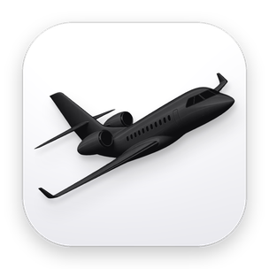
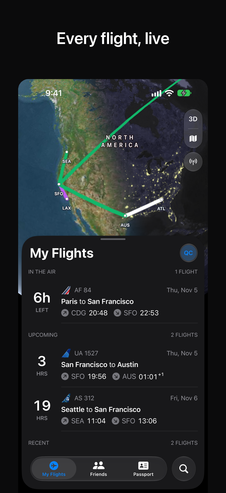
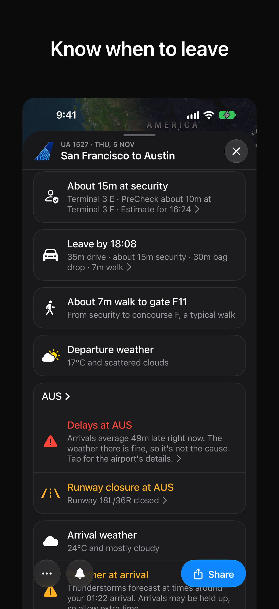
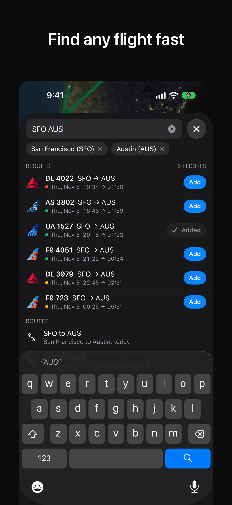
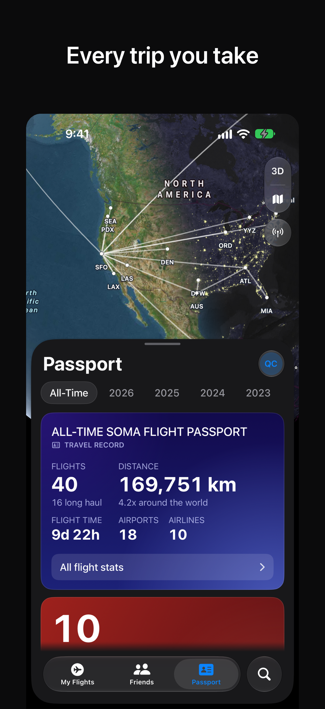
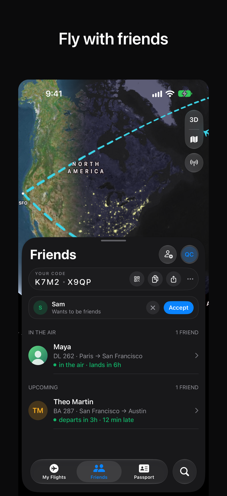
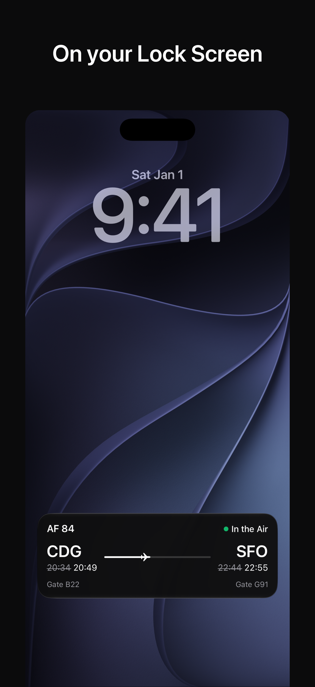
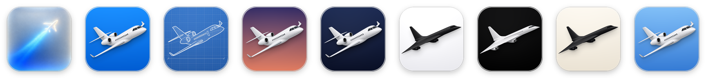
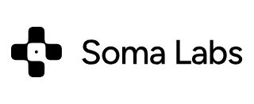

<div align="center">



# Soma Flight

**Live flight status and a log of every trip. For iPhone, Mac and Apple Watch.**

[](https://testflight.apple.com/join/RWVpDdDF)
[](https://somalabs.me)
[](LICENSE)


**[Try it](#try-it)** · **[Features](#features)** · **[Privacy](#privacy)** · **[Build from source](#build-from-source)** · **[Layout](#repository-layout)** · **[License](#license)**

</div>

Soma Flight follows your flights for you, from booking to baggage claim, and keeps a record of every trip you take. It tells you what is happening to your flight before the airline does, and it never sells, reads or tracks anything about you.

| My Flights | Flight | Search | Passport | Friends | Live Activity |
|---|---|---|---|---|---|
|  |  |  |  |  |  |

Screenshots show demo data.

## Try it

- **TestFlight (iPhone):** [join the public beta](https://testflight.apple.com/join/RWVpDdDF).
- **App Store:** version 1.0 is on its way. This line will link to it once it is live.
- **Website:** [somalabs.me](https://somalabs.me) · [Privacy policy](https://somalabs.me/legal/soma-flight-privacy) · [Support](https://somalabs.me/support)

## Features

- **Follow any flight.** Search by flight number, route or airport ("AF 84", "air france 84", "SFO AUS") and follow it in one tap. Times, gates, terminals and delays update on their own.
- **On your Lock Screen.** A Live Activity shows the countdown to departure, the time left in the air and the arrival gate, on the Lock Screen and in the Dynamic Island. Widgets keep your next flight on the Home Screen, and the Watch app puts it on your wrist.
- **Leave on time.** See when to leave for the airport, from the drive and how early you like to arrive.
- **Passport.** Flights you take land in your Passport an hour after the gate: a map of every route, distance flown, hours in the air, airports, airlines and aircraft. Import past trips from a file, a boarding pass or a confirmation email you share with the app. Export to JSON or CSV.
- **Friends.** Invite friends with a link and see their upcoming flights next to yours. You choose what they see.
- **Airports.** Weather (METAR), FAA status and the airlines that fly there.
- **Your icon.** Pick from more than 20 app icons: jets and a supersonic in every colour, blueprint and dusk, plus a contrail glowing in frosted glass.
- **Travel documents.** Loyalty numbers and passport details, sealed with AES-GCM on the device before they sync. The key stays in your iCloud Keychain.

<p align="center"></p>

## Privacy

- No ads, no analytics SDK, no tracking.
- Soma Flight never reads your mailbox or your contacts. Email import only reads a message you share or forward to the app, on the phone.
- Location is asked only for "Leave by", to compute the drive, and it never leaves the device. The camera is used only to scan a boarding pass.
- Settings > Account lets you export your data or delete your account. Deleting a Sign in with Apple account also revokes the Apple token.

The full policy is at [somalabs.me/legal/soma-flight-privacy](https://somalabs.me/legal/soma-flight-privacy).

## Build from source

You need Xcode 27 and [XcodeGen](https://github.com/yonaskolb/XcodeGen). The Rust core ships prebuilt in `Packages/FlightCoreFFI`; you need a Rust toolchain only to change it (`core/scripts/build-xcframework.sh` rebuilds the binding).

```bash
git clone https://github.com/soma-intelligence/Soma_Flight.git
cd Soma_Flight && xcodegen generate && open SomaFlight.xcodeproj
```

Debug builds run on fakes and need no account or key: run the iOS scheme on a simulator with the launch argument `-useFakes YES`. To use a real backend, run `supabase start` in this folder and point `Apps/*/Config.Debug.xcconfig` at it. Release builds refuse to start without real configuration.

The backend lives in `supabase/`: Postgres migrations, seed data and Deno Edge Functions. Flight data comes from [FlightAware AeroAPI](https://www.flightaware.com/commercial/aeroapi/), which needs your own key. See [docs/operations.md](docs/operations.md) and [docs/api-contract.md](docs/api-contract.md).

## Repository layout

- `Apps/`: the iOS, macOS and watchOS app targets, generated from `project.yml`.
- `Packages/FlightKit`: the shared SwiftUI app, services and tests.
- `core/` and `Packages/FlightCoreFFI`: the Rust core (`flightcore`) and its Swift bindings.
- `Apps/Web`: the web app (Vite, React), a first cut of the same app in the browser; see [its README](Apps/Web/README.md).
- `supabase/`: migrations, seed data and Edge Functions.
- `docs/`: API contract, operations, data sources and design notes.

[GOAL.md](GOAL.md) says where the project is heading.

## More from Soma Labs

- [OnePass](https://github.com/soma-intelligence/onepass): open source, post-quantum password manager.
- [Prism](https://github.com/soma-intelligence/prism): open source health app built on Apple Health.

## License

The code is released under the GNU Affero General Public License v3.0, see [LICENSE](LICENSE). Airline names, logos and other third-party marks are not covered by that license: see [NOTICE](NOTICE). Flight data provided by FlightAware.

<div align="center">
<br>
<a href="https://somalabs.me">
<picture>
  <source media="(prefers-color-scheme: dark)" srcset="docs/readme/soma-labs-white.png">
  
</picture>
</a>
<br>
<sub>Built by <a href="https://somalabs.me">Soma Labs</a>.</sub>
</div>
